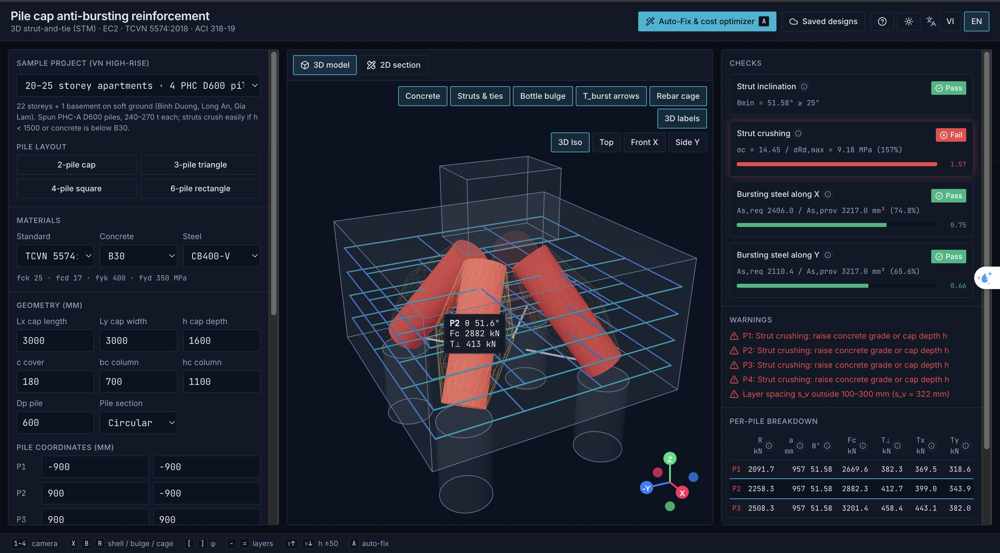
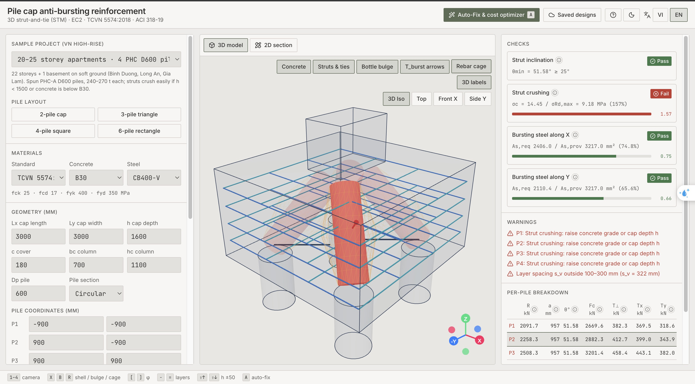
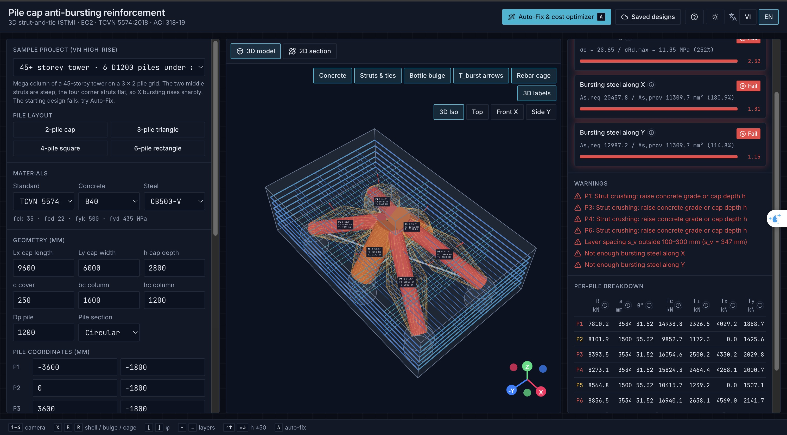
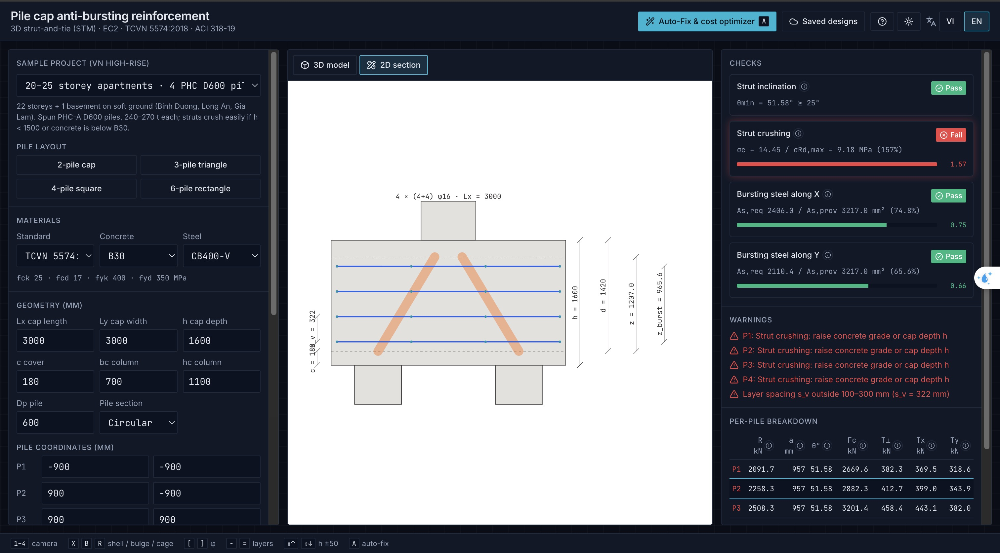
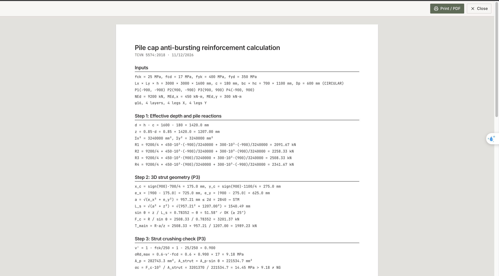

# Pile Cap Anti-Bursting Reinforcement

[Tiếng Việt](README.vi.md)



A browser tool for sizing the transverse steel that stops a pile cap from splitting, and for finding a cheaper cap that still passes. The model is a three-dimensional strut-and-tie idealisation (STM) of the concrete between a column and its piles. Checks follow the expressions implemented for Eurocode 2, TCVN 5574:2018 and ACI 318-19. The screen, the calculation note and the interface are in Vietnamese and English.

This is a design aid. The engineer of record checks the numbers against the project specification before they are used.

## The problem it solves

A pile cap is a deep block of concrete. The column load does not travel down as beam flexure. It travels as inclined compression struts from the column into each pile. Where a strut is wider in the middle than at its ends it is called a bottle-shaped strut. Concrete can carry the compression. The bulge produces a tension across the bottle, and that tension splits the cap unless transverse bars tie it together. Those bars are the anti-bursting reinforcement.

Three things fail in practice, often together:

1. The strut is too flat, so the compression and the splitting force both rise.
2. The concrete at the pile head crushes under the strut.
3. The cage has too little steel, the layers are too far apart, or the gaps are too tight for a poker vibrator.

Making the cap deeper fixes the struts and cuts the steel, and it also buys more concrete, formwork and excavation. Raising the concrete grade fixes crushing without digging deeper, and the concrete costs more per cubic metre. Changing only the cage is the right move when the concrete size is already frozen. The app prices all four of those effects and offers three repair strategies.

## What you can do

- Design any pile group. Type coordinates, or drop in a 2-pile, triangular 3-pile, square 4-pile or 3×2 six-pile layout at 3 pile-diameters spacing.
- Load six Vietnamese high-rise caps, from a 22-storey PHC building to a 45-storey mega-column whose starting cage fails on purpose.
- Pick the code (EC2, TCVN 5574:2018, ACI 318-19), a TCVN concrete grade B25–B50, and CB300-V, CB400-V or CB500-V.
- Enter cap size, cover, column size, pile diameter and shape (round or square), pile coordinates, and the column force and the two moments.
- Optionally add the cap’s own weight to the pile reactions used for a pile check. The struts keep using the column force only.
- Set the anti-bursting cage: bar diameter, number of layers (2–10), and the number of legs in X and in Y (2, 4, 6 or 8).
- Read four checks as they change: strut angle, crushing, steel in X, steel in Y. Each number has an info button that substitutes this design’s values into the formula.
- See warnings for a pile in tension, a cap that is too flexible for STM, a flat strut, crushing, layer spacing, and a shortfall of steel in either direction.
- Orbit a 3D model of the cap, the column, the piles, the bottle struts, the splitting arrows and the cage. Switch to a dimensioned 2D section.
- Open Auto-Fix and compare three feasible repairs with their cost in VND, then hover a card to preview it on the model before applying it.
- Read a cost-against-depth chart, and edit the unit prices.
- Check whether a Ø50 mm and a Ø70 mm poker fit through the cage.
- Print an A4 calculation note (six steps, every pile, the section).
- Sign in with an email link and save, rename, reopen or delete designs. Without Supabase credentials the rest of the app still runs.
- Switch dark and light theme, Vietnamese and English, and replay the first-run tour.
- Drive the model from the keyboard the way a CAD session expects.

## How a load becomes a cage

All geometry is in millimetres, forces in kN, moments in kN·m, stresses in MPa (N/mm²). The factor `10³` turns a moment in kN·m into kN·mm so that it divides cleanly by coordinates in millimetres and comes back out in kN.

`calculate` in `src/core/calculationEngine.ts` is a pure function. React never owns the arithmetic. Change any input and the screen recomputes.

### Step 1 — lever arm and pile reactions

The tension steel of the cap sits at the cover `c` above the soffit. The working depth and the internal lever arm are

```
d = h − c
z = 0.85 · d
```

`z = 0.85d` places the compression resultant inside the column node without building a rectangular stress block. The strut is taken as the straight line from that resultant down to the pile head.

Pile reactions about the group centroid, tension positive upward on the pile (compression in the strut when `R > 0`):

```
R = NEd / n
  + MEd,x · 10³ · y / Σy²
  + MEd,y · 10³ · x / Σx²
```

`n` is the number of piles. `Σx²` and `Σy²` are the sums of the squared coordinates. A zero sum (every pile on that axis) drops that moment term, so a two-pile cap on the X axis ignores `MEd,x` and still accepts `MEd,y`.

Sign example. Two piles at `x = −900` and `x = +900`, `MEd,y = +500 kN·m`. The term `MEd,y · x` adds compression to the pile on the positive X side and unloads the pile on the negative X side. `MEd,x` does the same thing along Y.

If `R ≤ 0` the pile is in tension. No strut is drawn. `Fc`, the bursting components and the crushing ratio are zero, and the pile is flagged `TENSION_PILE`. The other piles carry on.

Self-weight, only when the checkbox is on:

```
W = 25 kN/m³ · Lx · Ly · h · 10⁻⁹
Rtotal = R + W / n
```

`Rtotal` is the reaction to use when checking the pile itself. The strut force below is always computed from `R`. The cap weight is already inside the column load that the superstructure analysis reported, so adding it again into the strut would double-count it.

### Step 2 — the 3D strut

The column node is not the column centre and not the column face. It sits at a quarter of the column size, on the side toward the pile:

```
x_c = sign(x) · b_c / 4
y_c = sign(y) · h_c / 4
e_x = |x − x_c|
e_y = |y − y_c|
a   = √(e_x² + e_y²)
```

`sign` is +1, −1 or 0. A pile on the axis (`y = 0`) has `y_c = 0` and `e_y = 0`, so its splitting force has no Y component. That is why a two-pile edge cap has `T_design,Y = 0` and still needs Y bars only to tie the cage together.

Example. Column `600 × 600`, pile at `(+900, +900)`. The node is at `(+150, +150)`, inside the column (the face is at 300 mm). The horizontal run is `e_x = e_y = 750 mm`, so `a = 1060.7 mm`.

Strut length and inclination, with `z` vertical and `a` horizontal:

```
L_s    = √(a² + z²)
sin θ  = z / L_s
θ      = arcsin(sin θ)          in degrees
```

Plan angle of the same run, used later to split the tie into X and Y:

```
cos α = e_x / a
sin α = e_y / a
```

If `a = 0` the pile is directly under the node, both direction cosines are zero and there is no horizontal tie.

Two geometric warnings, neither of which stops the arithmetic:

- `a > 2d` (`FLEXIBLE_CAP`). The cap is spanning like a beam. STM is the wrong model; design it for flexure and punching.
- `θ < 25°` (`THETA_LOW`). The strut is too flat. Increase `h`.

Strut compression and the bottom tie that the main soffit steel must hold:

```
F_c    = R / sin θ
T_main = R · a / z          which is also R · cot θ
```

`T_main` is not the bursting force. It is the horizontal component that the bottom mat resists. Auto-Fix uses it when it prices that mat. A flatter strut (smaller `θ`, smaller `z` relative to `a`) raises both `F_c` and `T_main`.

### Step 3 — will the strut crush the concrete

The stress a bottle strut may carry is reduced below `fcd`:

```
ν′        = 1 − f_ck / 250
σ_Rd,max  = 0.6 · ν′ · f_cd
```

`f_ck` here is the cylinder strength stored on the grade (20 MPa for B25, 25 MPa for B30, and so on). `f_cd` is the TCVN design compressive strength `R_b`. The same `σ_Rd,max` is used for EC2, TCVN and ACI. Choosing ACI changes only the bursting force in Step 4.

The strut meets the pile on an ellipse (or a rectangle, for a square pile) whose area is the pile area times `sin θ`, because the strut axis is inclined to the pile head:

```
A_p     = π · D_p² / 4          or  D_p² for a square pile
A_strut = A_p · sin θ
σ_c     = F_c · 10³ / A_strut
UR      = σ_c / σ_Rd,max
```

Substitute `F_c = R / sin θ` and the stress is `R · 10³ / (A_p · sin²θ)`. Steepening the strut helps twice: the force along the strut drops, and the area it lands on grows. That is why an extra 200 mm of cap depth can remove a crushing failure that no reasonable amount of transverse steel can fix. Transverse steel ties the bottle; it does not raise `σ_Rd,max`.

`UR > 1` raises `CRUSHING_FAILURE` on that pile.

### Step 4 — tension across the bottle

`b_ef` is the strut width at the pile, `H_ef` is half the strut length (the length over which the bottle is allowed to spread), and `b_spread` is the width it would reach if unrestrained:

```
b_ef     = D_p · sin θ
H_ef     = L_s / 2
b_spread = b_ef + 0.5 · H_ef
```

The transverse tension `T⊥` depends on the code and on whether the bottle has room to spread.

ACI 318-19 §23.5, as implemented:

```
T⊥ = 0.25 · F_c
```

EC2 and TCVN. The bottle is called a full discontinuity when `b_ef / H_ef > 0.5` (the bearing is wide relative to the strut length, so the spread is restrained):

```
T⊥ = 0.25 · (1 − 0.7 · b_ef / H_ef) · F_c
```

Otherwise the spread can develop, and the tension is the share of the strut force that the spread geometry requires:

```
T⊥ = 0.25 · (b_spread − b_ef) / b_spread · F_c
```

`T⊥` acts across the strut axis. The horizontal tie the cage must provide is larger, because the strut is inclined:

```
T_h = T⊥ / sin θ
```

### Step 5 — one design force per direction

Resolve the horizontal tie along the plan of the strut:

```
T_x = T_h · cos α
T_y = T_h · sin α
```

Bars on the left of the column do not help bars on the right. Each half of the cap is summed on its own, and the design force is the worse half:

```
T_design,X = max( Σ T_x of piles with x ≥ 0 ,  Σ T_x of piles with x < 0 )
T_design,Y = max( Σ T_y of piles with y ≥ 0 ,  Σ T_y of piles with y < 0 )
```

A symmetric four-pile cap under pure axial load has equal halves, so `T_design,X` is the sum of the two piles on one side. A six-pile 3×2 cap is different: the two middle struts are steep and the four corner struts are flat, so the X sum grows quickly. Preset 05 is built to show that.

Required anti-bursting area, using the design yield strength `f_yd` (not a reduced stirrup strength):

```
A_s,req,X = T_design,X · 10³ / f_yd
A_s,req,Y = T_design,Y · 10³ / f_yd
```

### Step 6 — the cage you actually drew

Bursting steel is spread over the middle 80% of the lever arm. The lowest layer sits `0.1z` above the main steel:

```
z_burst        = 0.8 · z
s_v            = z_burst / max(n_layers − 1, 1)
z_bottom layer = c + 0.1 · z
```

One bar, and the steel provided in each direction (every layer contributes):

```
a_s1       = π · φ² / 4
A_s,prov,X = n_layers · n_legs,X · a_s1
A_s,prov,Y = n_layers · n_legs,Y · a_s1
UR_X       = A_s,req,X / A_s,prov,X
UR_Y       = A_s,req,Y / A_s,prov,Y
```

`UR > 1` raises `BURST_X_FAIL` or `BURST_Y_FAIL`. `s_v` outside 100–300 mm raises `SV_RANGE`. Those are the limits drawn on the results panel and in the printed note. Auto-Fix uses a tighter set, listed under the optimizer.

### Worked example

The numbers below are the benchmark in `src/core/calculationEngine.test.ts`. The test requires each of them within 1%.

Four piles at `(±900, ±900)` mm. `NEd = 8000 kN`, no moments. Cap `2700 × 2700 × 1500` mm, cover `c = 150` mm, column `600 × 600`, round piles `D_p = 600`. Concrete `f_ck = 25`, `f_cd = 14.5` MPa (the cylinder value and a B25 design strength). Steel `f_yd = 350` MPa. Cage: 4 layers of 4 + 4 legs, φ14.

| Quantity | Value | How |
|---|---|---|
| `d`, `z` | 1350 mm, 1147.5 mm | `1500 − 150`, then `0.85 · 1350` |
| `R` each pile | 2000 kN | `8000 / 4`, moments are zero |
| node `(x_c, y_c)` | `(±150, ±150)` mm | `sign · 600 / 4` |
| `a` | 1060.7 mm | `√(750² + 750²)`, and `a < 2d = 2700`, so STM applies |
| `L_s`, `θ` | 1562.6 mm, 47.25° | `sin θ = 0.7344` |
| `F_c` | 2724 kN | `2000 / 0.7344` |
| `σ_Rd,max` | 7.83 MPa | `ν′ = 1 − 25/250 = 0.9`, then `0.6 · 0.9 · 14.5` |
| `A_strut`, `σ_c` | 207 630 mm², 13.12 MPa | crushing UR ≈ 1.67, so the strut fails |
| `b_ef / H_ef` | 0.56 > 0.5 | full-discontinuity branch |
| `T⊥`, `T_h` | 412 kN, 561 kN | then `T_x = T_y = 397 kN` because `α = 45°` |
| `T_design,X` | 794 kN | two piles on the positive-X side |
| `A_s,req`, `A_s,prov` | 2268 mm², 2463 mm² | UR ≈ 0.92, steel passes |
| `s_v` | 306 mm | `0.8 · 1147.5 / 3`, outside 100–300 mm |

Reading the result the way the screen does: the cage is almost big enough and the layers are too far apart, but the real failure is crushing at the pile head. More φ16 bars would turn the bursting check greener and leave `σ_c` at 13 MPa against an allowable 7.8 MPa. The repair is a deeper cap, a higher grade, or both. That is the case Auto-Fix is for.

## Codes, grades, and what actually changes

| Code in the list | Bursting force `T⊥` | Crushing limit |
|---|---|---|
| EC2 | bottle-strut expressions above | `0.6 · ν′ · f_cd` |
| TCVN 5574:2018 | the same bottle-strut expressions | the same limit |
| ACI 318-19 | `0.25 · F_c` | the same limit |

Concrete grades follow TCVN 5574:2018 Table 7. `f_ck` is the cylinder strength used only inside `ν′`. `f_cd` is `R_b`.

| Grade | EC2 analogue | `f_ck` (MPa) | `f_cd` (MPa) | Default concrete price (VND/m³) |
|---|---|---|---|---|
| B25 | C20/25 | 20 | 14.5 | 1 450 000 |
| B30 | C25/30 | 25 | 17.0 | 1 580 000 |
| B35 | C30/37 | 30 | 19.5 | 1 720 000 |
| B40 | C35/45 | 35 | 22.0 | 1 890 000 |
| B45 | C40/50 | 40 | 25.0 | 2 100 000 |
| B50 | C45/55 | 45 | 27.5 | 2 350 000 |

`gradeOf` picks the grade whose `f_cd` is nearest the value on the input, so a hand-edited strength still lands on a price.

| Steel | `f_yk` (MPa) | `f_yd` (MPa) |
|---|---|---|
| CB300-V | 300 | 260 |
| CB400-V | 400 | 350 |
| CB500-V | 500 | 435 |

Bar diameters on the slider and on the `[` `]` keys: 10, 12, 14, 16, 18, 20, 22, 25 mm. Leg counts: 2, 4, 6, 8 per direction.

## Two sets of limits

The results panel tells you whether the current drawing passes. Auto-Fix asks for something a site can build, with a small margin.

| Check | On-screen pass | Required before Auto-Fix will offer it |
|---|---|---|
| Strut angle | `θ ≥ 25°` | shallowest active strut `≥ 26.5°` (`cot θ ≤ 2`) |
| Crushing | `UR ≤ 1` | `UR ≤ 0.98` |
| Bursting steel, each way | `UR ≤ 1` | `UR ≤ 0.98` |
| Layer spacing `s_v` | 100–300 mm | 110–280 mm |
| Clear gap between legs | shown on the vibrator gauge | `≥ 100` mm both ways |
| Bar diameter | any listed size | `φ ≥ 14` mm when `h ≥ 2000` mm |

Colours on a utilisation bar: green at or below 0.85, amber above 0.85 up to 1, red above 1.

## What the cap costs

`costOf` in `src/core/costOptimizer.ts` prices four physical things. Default unit rates are Vietnamese high-rise substructure prices and can be edited in the Auto-Fix panel. Money on screen is in millions of VND (`tr đ` / `M VND`).

Concrete volume and cost:

```
V      = Lx · Ly · h / 10⁹          m³
C_conc = V · price(grade)
```

Anti-bursting steel. Each leg spans the cap minus side cover, plus a 10φ hook at each end. Side cover `c_side = 75` mm, so `2 · 75 = 150` mm. Density of steel is 7850 kg/m³.

```
L_bar,X = (Lx − 150) + 20 · φ        mm
L_bar,Y = (Ly − 150) + 20 · φ
L_total = n_layers · (n_legs,X · L_bar,X + n_legs,Y · L_bar,Y) · 10⁻³     m
M_burst = L_total · (π · φ² / 4 · 10⁻⁶) · 7850                            kg
```

Main soffit steel. For each direction, sum `R · e / z` on the positive side and on the negative side, active piles only, and keep the worse side. Then take the greater of that steel and 0.15% of the gross section. The 1.18 factor pays for the hooks turned up the sides of the cap.

```
T_main,X = max( Σ R·e_x/z on x ≥ 0 ,  Σ R·e_x/z on x < 0 )
A_s,main,X = max( T_main,X · 10³ / f_yd ,  0.0015 · Ly · d )
M_main = 1.18 · (A_s,main,X · Lx + A_s,main,Y · Ly) · 10⁻⁹ · 7850
```

`T_main` uses `R · e / z`. The bursting design force uses `T⊥`. They are different bars and both are in the price.

Formwork is the four vertical faces. Excavation is the concrete volume plus 25% for working space:

```
A_form = 2 · (Lx + Ly) · h / 10⁶        m²
V_exc  = 1.25 · V                       m³
C_total = C_conc + (M_burst + M_main) · price_steel + A_form · price_form + V_exc · price_exc
```

Default prices besides concrete: steel 22 500 VND/kg, formwork 280 000 VND/m², excavation 320 000 VND/m³.

On preset 01 (`3000 × 3000 × 1600` mm, B30) that is `V = 14.4 m³` of concrete, `19.2 m²` of formwork and `18.0 m³` of excavation before any steel is added. The test `prices the concrete, formwork and excavation of VN_PRESET_01 by hand` locks those three.

## Auto-Fix is an exhaustive search, not a solver that iterates

The search space is a catalogue: depths on a 100 mm grid, six concrete grades, eight diameters, layers from 2 to 10, four leg counts each way. `bestRebar` walks that cage catalogue and keeps the lightest cage that clears every Auto-Fix limit. `solve` rejects the depth and grade first if the strut angle or the crushing ratio fails, then asks `bestRebar` for a cage, then prices the pair. There is no gradient and no random search. A single design is a few thousand cage checks and finishes in a frame.

Three cards come back. A card that fails names the reason: the strut still crushes (`STRUT_FAILS`), no cage fits (`NO_REBAR`), no grade up to B50 works at this depth (`NO_GRADE`), or nothing in the global window works (`NO_DESIGN`).

1. **Rebar only.** Depth and grade stay. Only the cage is replaced by the lightest legal one. Use this when architecture or the geotechnical drawing has frozen the concrete. If the strut is already crushed, the card says so and points at the other two.

2. **Raise the grade, keep the depth.** Every grade from the current one up to B50 is tried at the same `h`, each with its lightest cage, and the cheapest feasible one is kept. This is the card for a formation level that cannot go down (groundwater, a diaphragm wall, a neighbour). If the current grade already passes, this card usually matches card 1, because a higher grade only makes the same volume more expensive. If the current grade crushes, the walk up B30 → B35 → B40 is what removes the red bar.

3. **Lowest total cost.** Depth runs from `max(h − 800 mm, c + 600 mm)` to `h + 2000 mm` in steps of 100 mm. Grades are B30, B35, B40 and B45 only (B25 and B50 stay available on card 2 and in the material list). Each pair gets its lightest cage. The cheapest feasible pair wins. The saving is reported in VND and in percent against the design currently on screen. A positive delta means the repair costs more than a design that was already failing; the extra money is the cost of making it pass.

Hovering a feasible card copies that design into a preview. The 3D model, the 2D section and the result bars swap to it. The old utilisation stays as a dim bar behind the new one, and a label on the viewer says the scenario is only a preview. Applying writes it into the real input and toasts the change in cost and in kilograms of bursting steel. An infeasible card does not preview.

Under the cards, a chart varies depth from `h − 400` to `h + 600` mm (never shallower than `c + 300`) at one grade: the grade chosen by card 3 when that card is feasible, otherwise the current grade. Each depth is drawn with its own lightest legal cage when one exists. The blue line is concrete plus formwork plus excavation, and it rises with depth. The orange line is all the steel, and it falls as the struts steepen. The green line is the sum. A gold star marks the cheapest feasible depth on this sweep. A dashed line marks the depth you have now. Hatched red bands are depths whose strut still crushes. The star is the best depth at that one grade; card 3 may still pick a different depth because it also changes the grade and it searches a wider window.

## Constructability

`clearances` reports three gaps in millimetres:

```
s_clear,v = s_v − φ
s_clear,X = (Ly − 2 · 75) / (n_legs,X − 1) − φ
s_clear,Y = (Lx − 2 · 75) / (n_legs,Y − 1) − φ
s_clear,h = min(s_clear,X, s_clear,Y)
```

The gauge draws one cell of the cage with a Ø70 mm head and a dashed Ø50 mm head in the opening.

| State | Rule | Meaning |
|---|---|---|
| Green | vertical gap `≥ 120` mm and horizontal gap `≥ 150` mm | a Ø70 poker fits |
| Amber | anything between green and red | only the Ø50 poker fits |
| Red | vertical gap `< 100` mm or horizontal gap `< 100` mm | neither poker fits; fewer layers and a larger bar |

Auto-Fix enforces the 100 mm horizontal gap. The vertical gap is enforced only through the `s_v` window, so a large bar in a short `s_v` can still show red on the gauge after a card is applied. Read the gauge after you apply.

## Pile layouts and the six presets

`layoutGeometry` places piles at spacing `s = 3 · D_p`, centred on the column, then sizes the cap so the concrete edge is 150 mm outside the pile face:

```
Lx = (max x − min x) + D_p + 2 · 150
Ly = (max y − min y) + D_p + 2 · 150
```

| Button | Piles |
|---|---|
| 2-pile | on the X axis, at `±s/2` |
| 3-pile triangle | equilateral, one pile on +Y, the other two at 30° below the X axis |
| 4-pile square | at `(±s/2, ±s/2)` |
| 6-pile rectangle | three columns by two rows |

The cap is drawn about the centroid of the piles (`capCentre`), not about the column. On an eccentric group the column sits off-centre in the block. Preset 06 is that case: an 18-storey infill against a diaphragm wall, D800 piles shifted toward +X, a steep strut on the right and a long strut on the left.

All six presets use TCVN 5574:2018, circular piles, and self-weight off. Coordinates are in millimetres from the column centre. Loads are unfactored-looking service-to-design values already in the units the engine expects (`NEd` in kN, moments in kN·m); they are the design values `NEd`, `MEd,x`, `MEd,y`.

| Id | Building | Concrete, steel | Cap `Lx × Ly × h`, cover | Piles | Column load |
|---|---|---|---|---|---|
| 01 | 20–25 storeys, 4 PHC D600, soft ground | B30, CB400-V | 3000 × 3000 × 1600, c = 180 | `(±900, ±900)` | 9200 kN, 450 and 300 kN·m |
| 02 | 28–32 storeys, 3 bored D1000, equilateral | B35, CB400-V | 5000 × 4600 × 2100, c = 200 | `(0, +1732)`, `(±1500, −866)` | 19 500 kN, 850 and 600 kN·m |
| 03 | 35–40 storeys, 4 bored D1200 | B40, CB500-V | 6000 × 6000 × 2600, c = 220 | `(±1800, ±1800)` | 36 000 kN, 1600 and 1400 kN·m |
| 04 | 2-pile D1000 under an edge column or wall flange | B35, CB400-V | 5000 × 2200 × 2000, c = 200 | `(±1500, 0)` | 13 500 kN, `MEd,x = 0`, `MEd,y = 1100` |
| 05 | 45+ storeys, 6 D1200 under a mega column | B40, CB500-V | 9600 × 6000 × 2800, c = 250 | 3 × 2 at `x = −3600, 0, +3600` and `y = ±1800` | 50 000 kN, 2500 and 4200 kN·m |
| 06 | 18-storey infill, 4 eccentric D800 | B35, CB400-V | 4200 × 3800 × 1900, c = 180 | `x = −600 or +1800`, `y = ±1200` | 12 800 kN, 400 and 2800 kN·m |

Preset 02 is the unsymmetric 3D case: pile 1 lies on the Y axis, so its tie is entirely `T_y`; piles 2 and 3 split into both directions at 30°. Preset 04 is the plane case: `e_y = 0`, so `T_design,Y = 0`. Preset 05 starts overstressed so that Auto-Fix has something to repair. Preset 01 is the default design when the app opens.

Cover `c` on these caps is 180–250 mm, not the 25–40 mm of a beam. The pile is embedded 100–150 mm into the soffit and the main mat sits on top of the pile heads, so the centroid of the tension steel is a long way up from the bottom face.

## The 3D model

`PileCapScene3D` is loaded lazily, so the first paint does not wait for Three.js. React Three Fiber draws into a canvas; drei supplies cameras, orbit controls, edges, lines and the orientation gizmo.

Structural coordinates `(x, y, z)` are millimetres, `x` and `y` in plan, `z` upward. Three.js is Y-up and in metres:

```
(x_mm, y_mm, z_mm) → (x, z, −y) · 0.001
```

The gizmo is labelled `X`, `Z`, `−Y` for that reason. The minus on Y keeps a plan view, looking down, from mirroring the drawing.

What is on the canvas:

- The cap, a 800 mm column stub and 1000 mm of pile, drawn as translucent shells (`meshPhysicalMaterial`, opacity 0.16) with hard edges. Round piles are cylinders, square piles are boxes.
- One strut per active pile. A quaternion turns a Y-up cylinder onto the strut axis. The cylinder radius is `b_ef / 2`. A wireframe bulge out to `b_spread / 2` at mid-length is the bottle. Colour runs from amber toward orange as the crushing ratio rises, and turns red past 1. Click a strut to isolate it; the others dim. Click empty space to clear the selection. The same selection highlights the row in the pile table.
- A grey line from the node down to the level of the main steel, then the coloured strut continues to the pile head.
- Two red arrows at mid-strut, perpendicular to the strut axis. Their length scales with `T⊥` relative to the most heavily split pile.
- The cage. Layers sit at `z_bottom + k · s_v`. X legs are blue (`#3b82f6`) and run parallel to X, spread across Y. Y legs are cyan (`#06b6d4`). A rectangle ties each layer. The cage is centred on the pile centroid, so an eccentric cap still shows the steel inside the concrete.
- HTML labels on each strut: pile number, `θ`, `F_c`, `T⊥`.

Cameras: perspective iso (orbitable), and orthographic top, front (looking along Y) and side (looking along X). Orthographic views pan and zoom and do not tumble.

Layer toggles: concrete shell, strut-and-tie, bottle bulge, bursting arrows, cage, labels.

## The 2D section

`Section2D` is an elevation through the column centre, looking along Y, drawn in millimetres with SVG `y = −z` so up on the screen is up on the cap. It shows the cap, the column, the piles that this cut can see, the inclined struts, the Y-direction bars as dots, the X-direction bars as lines, and dimension strings for `h`, `d`, `z`, `z_burst`, `c` and `s_v`. The same drawing is embedded in the printed note.

## The formula button

`explain` in `src/core/formulas.ts` does not recompute the design. It prints the symbols, then the numbers already stored on the result, and it quotes the value the screen is showing. The popover is portaled to the document body so a scrollable panel cannot clip it. Only one popover is open at a time. Escape or a click outside closes it. If the pile you asked about is inactive, the bursting and crushing popovers say `R ≤ 0` and show zero.

## Calculation note

The print view is an A4 sheet (`210 mm` wide, 15 mm page margin on screen). It records the code and the date, the inputs, then the six steps with the governing pile written out in full (the pile with the largest `F_c`), a table of every pile, the warnings, and the section. `window.print()` sends it to a printer or a PDF driver. The dashboard is marked `no-print`, so the PDF is the note alone.

## Keyboard, theme, language, tour

Shortcuts are ignored while the pointer is in an input, a select, a textarea, or a content-editable node, and while Command, Ctrl or Alt is held.

| Keys | Action |
|---|---|
| `1` `2` `3` `4` | Iso, plan, front, side |
| `X` `B` `R` | Toggle the concrete shell, the bottle bulge, the cage |
| `[` `]` | Previous or next bar diameter |
| `-` `=` | Remove or add a layer, clamped to 2–10 |
| `Shift+↑` `Shift+↓` | Change `h` by 50 mm, never shallower than `c + 300` |
| `A` | Open or close Auto-Fix |

Theme and language are stored in `localStorage` (`theme`, `lang`). The first visit opens a twelve-step tour after a short wait; finishing or skipping sets `tourDone`. The `?` button runs it again. The tour closes Auto-Fix, clears any preview and returns the viewer to 3D before it measures its targets.

The typeface for words is Inter. Every coordinate, stress, area and price is JetBrains Mono with tabular figures, so a slider does not shove the layout sideways as digits change width.

## Cloud save

Optional. Set the two variables in `.env` (see `.env.example`) and restart Vite:

```
VITE_SUPABASE_URL=https://<project-ref>.supabase.co
VITE_SUPABASE_PUBLISHABLE_KEY=sb_publishable_...
```

If either is missing, `supabase` is `null` and the cloud button is not rendered.

Sign-in is a one-time email link (`signInWithOtp`), sent back to the site origin. There is no password in the app.

The table `public.designs` stores `id`, `user_id`, `name` (1–120 characters), `input` as JSON (a JSON object under 64 KB), `created_at` and `updated_at`. An index on `(user_id, updated_at desc)` serves the list. Row Level Security is on. Authenticated users may select, insert, update and delete only rows whose `user_id` equals `auth.uid()`. The anonymous role has no grants. Deleting the auth user cascades to that user’s designs.

Before a saved row is applied, `isDesignInput` checks that `material`, `load`, `detailing` and `geometry.piles` are present. A row that fails the check is not loaded.

Save updates the open design. Save as new inserts another row. The header shows the open design’s name.

## How the code is split

```
src/
  main.tsx                 React root
  App.tsx                  layout, shortcuts, preview, theme, language
  i18n.ts                  Vietnamese and English strings
  index.css                theme tokens
  core/
    calculationEngine.ts   the STM, no React
    formulas.ts            substituted formulas for the info buttons
    costOptimizer.ts       prices, cage search, three strategies, depth sweep
    presets.ts             grades, layouts, six buildings
    format.ts              numbers, money, utilisation colour
    *.test.ts              Vitest
  components/              panels, section, report, tour, formula popover
    viewer3d/              the Three.js scene, loaded on demand
  lib/supabase.ts          client, or null when unconfigured
supabase/migrations/       designs table and row-level policies
```

`DesignInput` is the whole problem: material, geometry, load, detailing. `DesignResult` is everything the screen and the note display, including per-pile geometry and the warning list. `Viewer3DConfig` (which layers, which camera, which pile) lives beside them and is not saved to the cloud; a reopened design starts from the default view.

The dashboard is three columns from the `xl` breakpoint up: inputs or Auto-Fix, the viewer, the checks. Below that, the viewer stacks under the inputs and the checks span the width. `calculate(input)` is memoised. A preview, when set, replaces both the viewer and the checks; the cost comparison still prices the un-previewed input so the toast measures the real change.

## Technologies

| Piece | Role |
|---|---|
| TypeScript 7 | types for inputs, results, warnings, strategies |
| React 19 | interface; `useMemo` for the calculation; context for language |
| Vite 8 | dev server, build, code-splitting the 3D scene |
| Tailwind CSS 4 | layout, dark and light tokens, print styles |
| three.js 0.187, React Three Fiber, drei | the viewer |
| Supabase JS 2.119 | email link auth, Postgres, row-level security |
| Vitest 5 | engine, formula text, and cost model |
| oxlint | lint |
| Inter, JetBrains Mono | words and figures |

Concepts the code is built on: strut-and-tie model, D-region (the whole cap is a discontinuity region), bottle-shaped strut, nodal zone at the quarter-point of the column, utilisation ratio, design-force envelope by half-cap, discrete catalogue search, an objective that sums concrete, both steels, formwork and excavation, derived state, a hover preview kept separate from the committed design, lazy loading, and row-level security.

## Run it

Requires Node.js.

```bash
npm install
npm run dev       # development server
npm test          # Vitest, once
npm run lint
npm run build     # tsc -b && vite build
npm run preview   # serve the production build
```

Copy `.env.example` to `.env` only if you want cloud save.

## What this version does not do

- It does not design the piles, the pile reinforcement, or the soil.
- It does not check punching shear, beam shear, or crack width as separate limit states. The layer-spacing window is the constructability stand-in for crack control.
- It does not design the main soffit mat as a selected bar mark. It estimates that mat’s weight for the price, from `T_main` and a 0.15% minimum.
- It does not switch the crushing limit over to an ACI strut-strength formula. ACI changes `T⊥` only.
- It does not move piles, the column size or the plan size of the cap during Auto-Fix. Those stay as drawn. Depth, grade and the cage are the variables.
- It does not treat the prices as a quotation. They are editable unit rates for ranking options.

# App Quick Look







