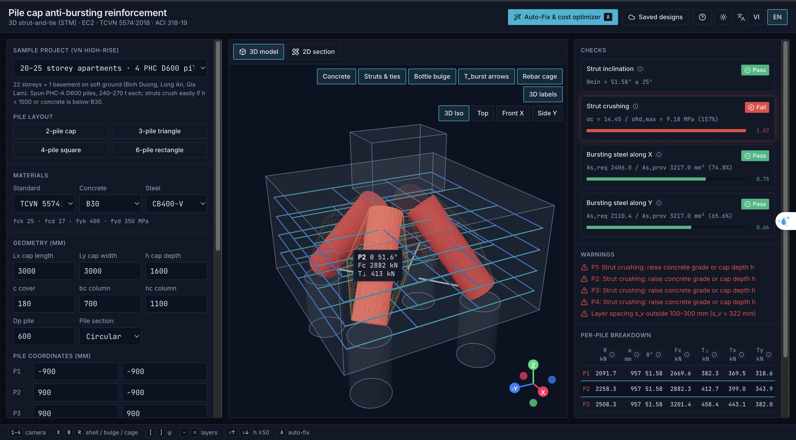
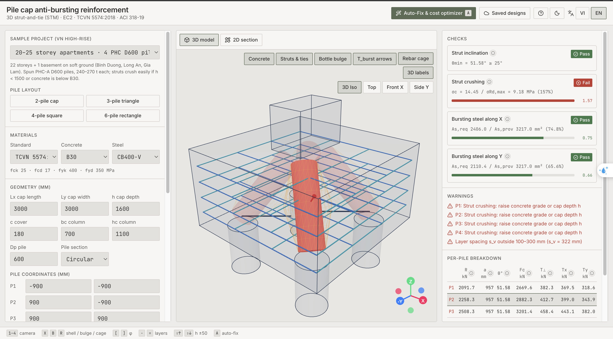
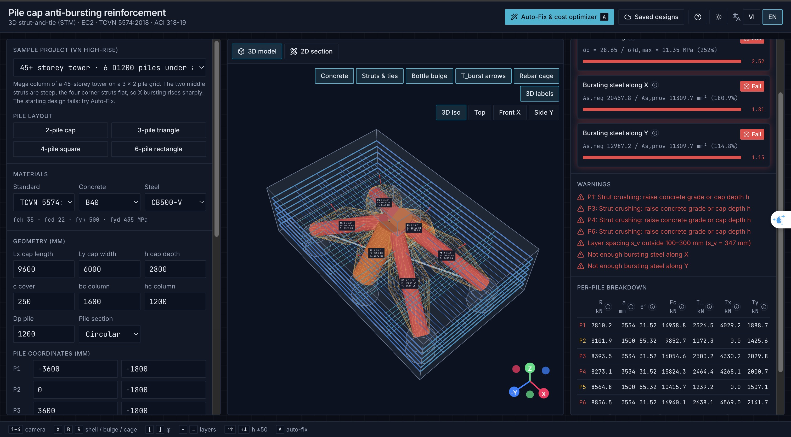
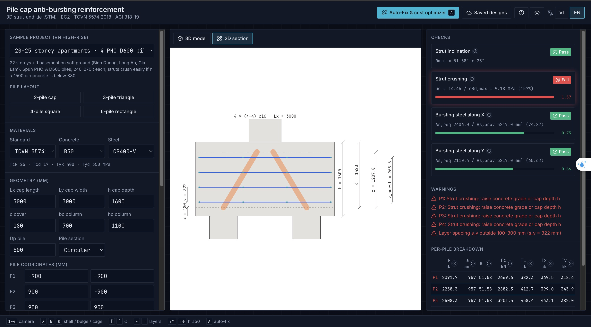
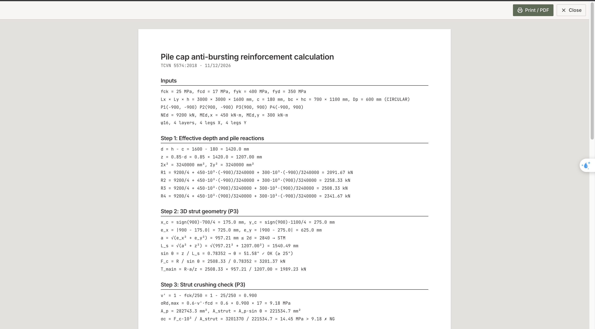

# Thép chống bứt tách đài cọc

[English](README.md)




Công cụ chạy trên trình duyệt để tính lớp thép ngang giữ cho đài cọc không bị nứt tách, và để tìm một đài rẻ hơn mà vẫn đạt. Mô hình là giàn ảo ba chiều (strut-and-tie, STM) của khối bê tông giữa cột và các cọc. Các kiểm tra dùng đúng biểu thức đã cài cho Eurocode 2, TCVN 5574:2018 và ACI 318-19. Màn hình, thuyết minh và giao diện có cả tiếng Việt và tiếng Anh.

Đây là công cụ hỗ trợ thiết kế. Kỹ sư chịu trách nhiệm đồ án đối chiếu lại với chỉ dẫn kỹ thuật của công trình trước khi dùng số liệu.

## Bài toán được giải

Đài cọc là một khối bê tông dày. Tải trọng cột không đi xuống theo kiểu uốn của dầm. Tải đi theo các thanh nén xiên, từ cột cắm xuống từng cọc. Thanh nén phình ở giữa, thắt ở hai đầu, gọi là thanh chống hình chai. Bê tông chịu được nén. Phần phình sinh ra lực kéo ngang qua thân chai, và lực kéo đó tách đôi đài nếu không có thép ngang buộc lại. Lớp thép đó là cốt thép chống bứt tách.

Trên công trình, ba thứ thường hỏng cùng lúc:

1. Thanh chống quá thoải, nên cả lực nén lẫn lực tách đều tăng.
2. Bê tông ở đầu cọc bị ép vỡ dưới thanh chống.
3. Lồng thép thiếu diện tích, các lớp đứng quá xa nhau, hoặc khe hở không lọt đầm dùi.

Tăng chiều cao đài làm thanh chống dốc hơn và giảm thép, đồng thời mua thêm bê tông, ván khuôn và đất đào. Tăng mác bê tông chữa được ép vỡ mà không phải đào sâu hơn, và đơn giá bê tông tăng. Chỉ sửa lồng thép là đúng khi kích thước bê tông đã chốt. Ứng dụng cộng cả bốn khoản đó rồi đưa ra ba cách sửa.

## Những gì làm được

- Thiết kế nhóm cọc bất kỳ. Gõ tọa độ, hoặc thả sẵn đài 2 cọc, 3 cọc tam giác, 4 cọc vuông, 6 cọc lưới 3×2, khoảng cách tim 3 lần đường kính cọc.
- Mở sáu đài nhà cao tầng ở Việt Nam, từ chung cư 22 tầng trên cọc PHC đến cột mega 45 tầng có lồng thép ban đầu cố tình không đạt.
- Chọn tiêu chuẩn (EC2, TCVN 5574:2018, ACI 318-19), cấp độ bền B25–B50, và thép CB300-V, CB400-V hoặc CB500-V.
- Nhập kích thước đài, lớp bảo vệ, tiết diện cột, đường kính và hình dạng cọc (tròn hoặc vuông), tọa độ cọc, lực dọc và hai mô men chân cột.
- Có thể cộng trọng lượng bản thân đài vào phản lực dùng để kiểm tra cọc. Thanh chống vẫn chỉ dùng lực từ cột.
- Chọn lồng thép chống bứt tách: đường kính, số lớp (2–10), số nhánh phương X và phương Y (2, 4, 6 hoặc 8).
- Đọc bốn kiểm tra cập nhật ngay: góc nghiêng, ép vỡ, thép phương X, thép phương Y. Mỗi số có nút thông tin, thay đúng số của phương án này vào công thức.
- Xem cảnh báo khi có cọc chịu kéo, đài quá mềm để dùng STM, thanh chống quá thoải, ép vỡ, khoảng cách lớp, và thiếu thép từng phương.
- Xoay mô hình 3D của đài, cột, cọc, thanh chống hình chai, mũi tên lực tách và lồng thép. Chuyển sang mặt cắt 2D có ghi kích thước.
- Mở Tự động sửa, so sánh ba phương án kèm chi phí tính bằng đồng, rê chuột lên một thẻ để xem trước trên mô hình rồi mới áp dụng.
- Xem biểu đồ chi phí theo chiều cao đài, và sửa đơn giá.
- Kiểm tra đầm dùi Ø50 mm và Ø70 mm có lọt qua lồng thép hay không.
- In thuyết minh khổ A4 (sáu bước, đủ mọi cọc, kèm mặt cắt).
- Đăng nhập bằng liên kết gửi qua email, rồi lưu, đổi tên, mở lại hoặc xóa thiết kế. Không có khóa Supabase thì phần còn lại của ứng dụng vẫn chạy.
- Đổi nền tối và nền sáng, tiếng Việt và tiếng Anh, và xem lại hướng dẫn lần đầu.
- Điều khiển mô hình bằng bàn phím theo thói quen một phiên CAD.

## Từ tải trọng đến lồng thép

Mọi kích thước tính bằng milimét, lực bằng kN, mô men bằng kN·m, ứng suất bằng MPa (N/mm²). Hệ số `10³` đổi mô men từ kN·m sang kN·mm, để chia cho tọa độ milimét rồi ra lại đơn vị kN.

Hàm `calculate` trong `src/core/calculationEngine.ts` là hàm thuần. React không giữ phép tính. Sửa một ô đầu vào là màn hình tính lại.

### Bước 1 — cánh tay đòn và phản lực cọc

Thép chịu kéo ở đáy đài nằm cao hơn đáy một khoảng bằng lớp bảo vệ `c`. Chiều cao làm việc và cánh tay đòn nội lực:

```
d = h − c
z = 0.85 · d
```

`z = 0.85d` đặt hợp lực nén vào trong nút ở cột, không cần dựng biểu đồ ứng suất hình chữ nhật. Thanh chống là đoạn thẳng từ hợp lực đó xuống đầu cọc.

Phản lực cọc quanh trọng tâm nhóm cọc. `R > 0` là cọc chịu nén, và thanh chống cũng chịu nén:

```
R = NEd / n
  + MEd,x · 10³ · y / Σy²
  + MEd,y · 10³ · x / Σx²
```

`n` là số cọc. `Σx²` và `Σy²` là tổng bình phương tọa độ. Tổng bằng không (mọi cọc nằm trên trục đó) thì bỏ số hạng mô men tương ứng. Đài hai cọc trên trục X bỏ qua `MEd,x` và vẫn nhận `MEd,y`.

Ví dụ dấu. Hai cọc tại `x = −900` và `x = +900`, `MEd,y = +500 kN·m`. Số hạng `MEd,y · x` cộng thêm nén cho cọc phía X dương và giảm nén cho cọc phía X âm. `MEd,x` làm việc đó theo phương Y.

Nếu `R ≤ 0`, cọc chịu kéo. Không vẽ thanh chống. `Fc`, các thành phần bứt tách và hệ số ép vỡ bằng không, cọc bị gắn mã `TENSION_PILE`. Các cọc còn lại vẫn tính.

Trọng lượng bản thân, chỉ khi bật ô chọn:

```
W = 25 kN/m³ · Lx · Ly · h · 10⁻⁹
Rtotal = R + W / n
```

`Rtotal` là phản lực dùng khi kiểm tra sức chịu của bản thân cọc. Lực trong thanh chống ở các bước sau luôn lấy từ `R`. Trọng lượng đài đã nằm trong lực chân cột mà mô hình kết cấu phần thân trả về; cộng thêm một lần nữa vào thanh chống là tính trùng.

### Bước 2 — thanh chống trong không gian

Nút ở cột không phải tâm cột, cũng không phải mép cột. Nút nằm ở một phần tư kích thước cột, về phía cọc đang xét:

```
x_c = sign(x) · b_c / 4
y_c = sign(y) · h_c / 4
e_x = |x − x_c|
e_y = |y − y_c|
a   = √(e_x² + e_y²)
```

`sign` là +1, −1 hoặc 0. Cọc nằm trên trục (`y = 0`) có `y_c = 0` và `e_y = 0`, nên lực tách không có thành phần Y. Vì vậy đài hai cọc dưới cột biên có `T_design,Y = 0`; thép phương Y chỉ để ôm lồng.

Ví dụ. Cột `600 × 600`, cọc tại `(+900, +900)`. Nút nằm tại `(+150, +150)`, vẫn trong tiết diện cột (mép cột ở 300 mm). Đoạn ngang là `e_x = e_y = 750 mm`, nên `a = 1060,7 mm`.

Chiều dài và góc nghiêng, `z` thẳng đứng, `a` nằm ngang:

```
L_s    = √(a² + z²)
sin θ  = z / L_s
θ      = arcsin(sin θ)          độ
```

Góc trên mặt bằng của cùng đoạn ngang đó, lát nữa dùng để tách lực giằng ra X và Y:

```
cos α = e_x / a
sin α = e_y / a
```

Nếu `a = 0`, cọc nằm ngay dưới nút, cả hai cosin hướng bằng không và không có lực giằng ngang.

Hai cảnh báo hình học. Phép tính vẫn chạy.

- `a > 2d` (`FLEXIBLE_CAP`). Đài làm việc như một dầm. STM không còn là mô hình đúng; tính uốn và chọc thủng.
- `θ < 25°` (`THETA_LOW`). Thanh chống quá thoải. Tăng `h`.

Lực nén trong thanh chống, và lực kéo đáy mà thép chủ mặt dưới phải giữ:

```
F_c    = R / sin θ
T_main = R · a / z          cũng chính là R · cot θ
```

`T_main` không phải lực bứt tách. Đó là thành phần ngang do thép chủ đáy chịu. Tự động sửa dùng nó khi tính tiền lớp thép này. Thanh chống càng thoải (θ nhỏ, `z` nhỏ so với `a`) thì cả `F_c` lẫn `T_main` cùng tăng.

### Bước 3 — bê tông thanh chống có bị ép vỡ không

Ứng suất cho phép của thanh chống hình chai thấp hơn `fcd`:

```
ν′        = 1 − f_ck / 250
σ_Rd,max  = 0.6 · ν′ · f_cd
```

`f_ck` ở đây là cường độ mẫu trụ lưu trên cấp độ bền (20 MPa với B25, 25 MPa với B30, …). `f_cd` là cường độ chịu nén tính toán `R_b` của TCVN. Cùng một `σ_Rd,max` dùng cho EC2, TCVN và ACI. Chọn ACI chỉ đổi lực bứt tách ở bước 4.

Thanh chống gặp đầu cọc trên một hình elip (hoặc hình chữ nhật nếu cọc vuông). Diện tích tiếp xúc bằng diện tích đầu cọc nhân `sin θ`, vì trục thanh chống xiên so với mặt đầu cọc:

```
A_p     = π · D_p² / 4          hoặc  D_p² nếu cọc vuông
A_strut = A_p · sin θ
σ_c     = F_c · 10³ / A_strut
UR      = σ_c / σ_Rd,max
```

Thay `F_c = R / sin θ` thì ứng suất là `R · 10³ / (A_p · sin²θ)`. Làm thanh chống dốc hơn có lợi hai lần: lực dọc trục giảm, và diện tích nó tì lên tăng. Thêm 200 mm chiều cao đài có thể xóa một lỗi ép vỡ mà thêm bao nhiêu thép ngang cũng không chữa được. Thép ngang buộc cái chai; nó không nâng `σ_Rd,max`.

`UR > 1` gắn `CRUSHING_FAILURE` cho cọc đó.

### Bước 4 — lực kéo ngang qua thân chai

`b_ef` là bề rộng thanh chống tại đầu cọc, `H_ef` là một nửa chiều dài thanh chống (quãng đường thân chai được phép phình), `b_spread` là bề rộng nó đạt tới nếu không bị kìm:

```
b_ef     = D_p · sin θ
H_ef     = L_s / 2
b_spread = b_ef + 0.5 · H_ef
```

Lực kéo ngang `T⊥` phụ thuộc tiêu chuẩn và chỗ phình còn khoảng trống hay không.

ACI 318-19 §23.5, đúng như đã cài:

```
T⊥ = 0.25 · F_c
```

EC2 và TCVN. Thân chai bị coi là gián đoạn toàn phần khi `b_ef / H_ef > 0.5` (mặt tì rộng so với chiều dài thanh chống, phần phình bị kìm lại):

```
T⊥ = 0.25 · (1 − 0.7 · b_ef / H_ef) · F_c
```

Trường hợp còn lại, phần phình phát triển được, và lực kéo là phần lực thanh chống mà hình học chỗ phình đòi hỏi:

```
T⊥ = 0.25 · (b_spread − b_ef) / b_spread · F_c
```

`T⊥` vuông góc với trục thanh chống. Lực giằng nằm ngang mà lồng thép phải chịu lớn hơn, vì thanh chống đang xiên:

```
T_h = T⊥ / sin θ
```

### Bước 5 — một lực thiết kế cho mỗi phương

Chiếu lực giằng ngang lên mặt bằng của thanh chống:

```
T_x = T_h · cos α
T_y = T_h · sin α
```

Thép bên trái cột không giúp thép bên phải. Mỗi nửa đài được cộng riêng, lực thiết kế là nửa lớn hơn:

```
T_design,X = max( Σ T_x của các cọc có x ≥ 0 ,  Σ T_x của các cọc có x < 0 )
T_design,Y = max( Σ T_y của các cọc có y ≥ 0 ,  Σ T_y của các cọc có y < 0 )
```

Đài bốn cọc đối xứng, chỉ chịu lực dọc, hai nửa bằng nhau, nên `T_design,X` là tổng của hai cọc một phía. Đài sáu cọc lưới 3×2 thì khác: hai thanh chống giữa rất dốc, bốn thanh chống góc rất thoải, nên tổng phương X tăng nhanh. Mẫu 05 được dựng để thấy điều đó.

Diện tích thép chống bứt tách yêu cầu, dùng cường độ tính toán `f_yd` (không dùng cường độ giảm của thép đai):

```
A_s,req,X = T_design,X · 10³ / f_yd
A_s,req,Y = T_design,Y · 10³ / f_yd
```

### Bước 6 — lồng thép đang vẽ

Thép chống bứt tách rải trong 80% giữa của cánh tay đòn. Lớp thấp nhất nằm cao hơn thép chủ một đoạn `0,1z`:

```
z_burst     = 0.8 · z
s_v         = z_burst / max(số lớp − 1, 1)
z lớp dưới  = c + 0.1 · z
```

Một thanh, và thép bố trí theo mỗi phương (mọi lớp đều được tính):

```
a_s1       = π · φ² / 4
A_s,prov,X = số lớp · số nhánh X · a_s1
A_s,prov,Y = số lớp · số nhánh Y · a_s1
UR_X       = A_s,req,X / A_s,prov,X
UR_Y       = A_s,req,Y / A_s,prov,Y
```

`UR > 1` gắn `BURST_X_FAIL` hoặc `BURST_Y_FAIL`. `s_v` ngoài khoảng 100–300 mm gắn `SV_RANGE`. Đó là giới hạn trên bảng kết quả và trong thuyết minh in. Tự động sửa dùng bộ chặt hơn, ghi ở phần thuật toán bên dưới.

### Ví dụ tính tay

Các số dưới đây là bài chuẩn trong `src/core/calculationEngine.test.ts`. Kiểm thử đòi từng số sai lệch dưới 1%.

Bốn cọc tại `(±900, ±900)` mm. `NEd = 8000 kN`, không có mô men. Đài `2700 × 2700 × 1500` mm, lớp bảo vệ `c = 150` mm, cột `600 × 600`, cọc tròn `D_p = 600`. Bê tông `f_ck = 25`, `f_cd = 14,5` MPa (cường độ trụ và cường độ tính toán cấp B25). Thép `f_yd = 350` MPa. Lồng: 4 lớp, 4 + 4 nhánh, φ14.

| Đại lượng | Giá trị | Cách ra |
|---|---|---|
| `d`, `z` | 1350 mm, 1147,5 mm | `1500 − 150`, rồi `0,85 · 1350` |
| `R` mỗi cọc | 2000 kN | `8000 / 4`, mô men bằng không |
| nút `(x_c, y_c)` | `(±150, ±150)` mm | `sign · 600 / 4` |
| `a` | 1060,7 mm | `√(750² + 750²)`, và `a < 2d = 2700`, nên dùng được STM |
| `L_s`, `θ` | 1562,6 mm, 47,25° | `sin θ = 0,7344` |
| `F_c` | 2724 kN | `2000 / 0,7344` |
| `σ_Rd,max` | 7,83 MPa | `ν′ = 1 − 25/250 = 0,9`, rồi `0,6 · 0,9 · 14,5` |
| `A_strut`, `σ_c` | 207 630 mm², 13,12 MPa | UR ép vỡ ≈ 1,67, thanh chống không đạt |
| `b_ef / H_ef` | 0,56 > 0,5 | nhánh gián đoạn toàn phần |
| `T⊥`, `T_h` | 412 kN, 561 kN | rồi `T_x = T_y = 397 kN` vì `α = 45°` |
| `T_design,X` | 794 kN | hai cọc phía X dương |
| `A_s,req`, `A_s,prov` | 2268 mm², 2463 mm² | UR ≈ 0,92, thép đạt |
| `s_v` | 306 mm | `0,8 · 1147,5 / 3`, ngoài 100–300 mm |

Đọc kết quả theo cách màn hình đọc: lồng thép gần đủ và các lớp đứng quá xa, nhưng hỏng thật sự là ép vỡ ở đầu cọc. Thêm thép φ16 làm vạch kiểm tra bứt tách xanh hơn và vẫn để `σ_c` ở 13 MPa trong khi cho phép chỉ 7,8 MPa. Cách sửa là tăng chiều cao, tăng mác, hoặc cả hai. Đó là việc của Tự động sửa.

## Tiêu chuẩn, cấp độ bền, và cái gì thực sự đổi

| Tiêu chuẩn trong danh sách | Lực bứt tách `T⊥` | Giới hạn ép vỡ |
|---|---|---|
| EC2 | biểu thức thanh chống hình chai ở trên | `0,6 · ν′ · f_cd` |
| TCVN 5574:2018 | cùng biểu thức đó | cùng giới hạn |
| ACI 318-19 | `0,25 · F_c` | cùng giới hạn |

Cấp độ bền theo Bảng 7 của TCVN 5574:2018. `f_ck` là cường độ mẫu trụ, chỉ dùng trong `ν′`. `f_cd` là `R_b`.

| Cấp | Tương đương EC2 | `f_ck` (MPa) | `f_cd` (MPa) | Đơn giá bê tông mặc định (đồng/m³) |
|---|---|---|---|---|
| B25 | C20/25 | 20 | 14,5 | 1 450 000 |
| B30 | C25/30 | 25 | 17,0 | 1 580 000 |
| B35 | C30/37 | 30 | 19,5 | 1 720 000 |
| B40 | C35/45 | 35 | 22,0 | 1 890 000 |
| B45 | C40/50 | 40 | 25,0 | 2 100 000 |
| B50 | C45/55 | 45 | 27,5 | 2 350 000 |

`gradeOf` chọn cấp có `f_cd` gần giá trị đang nhập nhất, nên một cường độ sửa tay vẫn rơi vào một đơn giá.

| Thép | `f_yk` (MPa) | `f_yd` (MPa) |
|---|---|---|
| CB300-V | 300 | 260 |
| CB400-V | 400 | 350 |
| CB500-V | 500 | 435 |

Đường kính trên thanh trượt và trên phím `[` `]`: 10, 12, 14, 16, 18, 20, 22, 25 mm. Số nhánh: 2, 4, 6, 8 mỗi phương.

## Hai bộ giới hạn

Bảng kết quả cho biết bản vẽ hiện tại có đạt hay không. Tự động sửa đòi một thứ công trường làm được, kèm một ít dự trữ.

| Kiểm tra | Đạt trên màn hình | Tự động sửa mới chịu đề xuất |
|---|---|---|
| Góc thanh chống | `θ ≥ 25°` | thanh chống thoải nhất của cọc đang chịu nén `≥ 26,5°` (`cot θ ≤ 2`) |
| Ép vỡ | `UR ≤ 1` | `UR ≤ 0,98` |
| Thép chống bứt tách, mỗi phương | `UR ≤ 1` | `UR ≤ 0,98` |
| Khoảng cách lớp `s_v` | 100–300 mm | 110–280 mm |
| Khe hở giữa các nhánh | hiện trên thước đầm dùi | `≥ 100` mm cả hai phương |
| Đường kính | mọi cỡ trong danh sách | `φ ≥ 14` mm khi `h ≥ 2000` mm |

Màu của vạch hệ số sử dụng: xanh lục khi không quá 0,85, hổ phách khi trên 0,85 đến 1, đỏ khi trên 1.

## Đài này tốn bao nhiêu

`costOf` trong `src/core/costOptimizer.ts` tính tiền cho bốn thứ có thật. Đơn giá mặc định là mặt bằng phần ngầm nhà cao tầng ở Việt Nam, sửa được trong bảng Tự động sửa. Tiền trên màn hình ghi theo triệu đồng (`tr đ` / `M VND`).

Thể tích và tiền bê tông:

```
V      = Lx · Ly · h / 10⁹          m³
C_bt   = V · đơn giá(cấp độ bền)
```

Thép chống bứt tách. Mỗi nhánh chạy suốt đài trừ lớp bảo vệ mặt bên, cộng một móc 10φ mỗi đầu. Lớp bảo vệ bên `c_side = 75` mm, nên `2 · 75 = 150` mm. Khối lượng riêng thép 7850 kg/m³.

```
L_thanh,X = (Lx − 150) + 20 · φ        mm
L_thanh,Y = (Ly − 150) + 20 · φ
L_tổng    = số lớp · (nhánh X · L_thanh,X + nhánh Y · L_thanh,Y) · 10⁻³     m
M_burst   = L_tổng · (π · φ² / 4 · 10⁻⁶) · 7850                               kg
```

Thép chủ đáy. Mỗi phương, cộng `R · e / z` phía dương và phía âm, chỉ các cọc đang chịu nén, giữ phía lớn hơn. Rồi lấy số lớn hơn giữa lượng thép đó và 0,15% tiết diện nguyên. Hệ số 1,18 trả cho đoạn móc bẻ lên thành đài.

```
T_main,X   = max( Σ R·e_x/z với x ≥ 0 ,  Σ R·e_x/z với x < 0 )
A_s,main,X = max( T_main,X · 10³ / f_yd ,  0,0015 · Ly · d )
M_main     = 1,18 · (A_s,main,X · Lx + A_s,main,Y · Ly) · 10⁻⁹ · 7850
```

`T_main` dùng `R · e / z`. Lực thiết kế chống bứt tách dùng `T⊥`. Đó là hai lớp thép khác nhau, và cả hai đều nằm trong giá.

Ván khuôn là bốn mặt đứng. Đào đất bằng thể tích bê tông cộng 25% cho hố thi công:

```
A_vk    = 2 · (Lx + Ly) · h / 10⁶        m²
V_đào   = 1,25 · V                       m³
C_tổng  = C_bt + (M_burst + M_main) · giá thép + A_vk · giá ván khuôn + V_đào · giá đào
```

Đơn giá mặc định ngoài bê tông: thép 22 500 đồng/kg, ván khuôn 280 000 đồng/m², đào đất 320 000 đồng/m³.

Với mẫu 01 (`3000 × 3000 × 1600` mm, B30), riêng phần bê tông đã là `V = 14,4 m³`, ván khuôn `19,2 m²`, đào `18,0 m³`, chưa kể thép. Kiểm thử `prices the concrete, formwork and excavation of VN_PRESET_01 by hand` khóa ba con số đó.

## Tự động sửa là vét hết danh mục, không phải một solver lặp

Không gian tìm là một danh mục: chiều cao bước 100 mm, sáu cấp bê tông, tám đường kính, số lớp từ 2 đến 10, bốn mức số nhánh mỗi phương. `bestRebar` đi hết danh mục lồng thép và giữ lồng nhẹ nhất vượt mọi giới hạn của Tự động sửa. `solve` loại chiều cao và mác ngay nếu góc nghiêng hoặc hệ số ép vỡ không đạt, rồi hỏi `bestRebar` một lồng thép, rồi tính tiền của cặp đó. Không có đạo hàm, không có tìm ngẫu nhiên. Một phương án là vài nghìn lần thử lồng thép và xong trong một khung hình.

Ba thẻ được trả về. Thẻ không đạt ghi lý do: thanh chống vẫn ép vỡ (`STRUT_FAILS`), không có lồng nào vừa (`NO_REBAR`), không cấp nào đến B50 chịu được ở chiều cao này (`NO_GRADE`), hoặc không có gì trong cửa sổ tìm toàn cục (`NO_DESIGN`).

1. **Chỉ điều chỉnh thép.** Chiều cao và mác giữ nguyên. Chỉ thay lồng bằng lồng hợp lệ nhẹ nhất. Dùng khi kiến trúc hoặc hồ sơ địa chất đã khóa kích thước bê tông. Nếu thanh chống đã ép vỡ, thẻ nói thẳng và chỉ sang hai thẻ kia.

2. **Tăng mác, giữ chiều cao.** Mọi cấp từ mác hiện tại lên đến B50 được thử ở cùng `h`, mỗi cấp với lồng nhẹ nhất của nó, và giữ phương án khả thi rẻ nhất. Đây là thẻ cho cao độ đáy móng không hạ thêm được (nước ngầm, tường vây, công trình lân cận). Nếu mác hiện tại đã đạt, thẻ này thường trùng thẻ 1, vì tăng mác chỉ làm cùng một thể tích đắt hơn. Nếu mác hiện tại bị ép vỡ, việc đi lên B30 → B35 → B40 chính là thứ xóa vạch đỏ.

3. **Tổng chi phí nhỏ nhất.** Chiều cao chạy từ `max(h − 800 mm, c + 600 mm)` đến `h + 2000 mm`, bước 100 mm. Mác chỉ gồm B30, B35, B40 và B45 (B25 và B50 vẫn chọn được ở thẻ 2 và trong danh sách vật liệu). Mỗi cặp nhận lồng nhẹ nhất. Cặp khả thi rẻ nhất thắng. Mức tiết kiệm ghi bằng đồng và bằng phần trăm so với phương án đang mở. Chênh dương nghĩa là phương án sửa đắt hơn một bản vẽ vốn đã không đạt; khoản thêm đó là tiền để làm cho nó đạt.

Rê chuột lên một thẻ khả thi thì chép phương án đó vào bản xem trước. Mô hình 3D, mặt cắt 2D và các vạch kết quả đổi theo. Hệ số sử dụng cũ nằm thành một vạch mờ phía sau vạch mới, và nhãn trên khung nhìn nói rằng đây mới chỉ là xem trước. Bấm Áp dụng thì ghi vào số liệu thật và hiện thông báo chênh chi phí cùng số kilôgam thép chống bứt tách. Thẻ không khả thi không xem trước được.

Dưới các thẻ, biểu đồ đổi chiều cao từ `h − 400` đến `h + 600` mm (không nông hơn `c + 300`) ở một mác: mác của thẻ 3 nếu thẻ đó khả thi, không thì mác hiện tại. Mỗi chiều cao được vẽ với lồng hợp lệ nhẹ nhất của nó khi lồng đó tồn tại. Đường xanh lam là bê tông cộng ván khuôn cộng đào đất, tăng theo chiều cao. Đường cam là toàn bộ thép, giảm khi thanh chống dốc lên. Đường xanh lục là tổng. Ngôi sao vàng đánh dấu chiều cao khả thi rẻ nhất trên lần quét này. Nét đứt là chiều cao đang có. Vùng gạch chéo đỏ là những chiều cao mà thanh chống vẫn ép vỡ. Ngôi sao là chiều cao tốt nhất của riêng mác đó; thẻ 3 vẫn có thể chọn chiều cao khác vì nó còn đổi mác và nó tìm trên một cửa sổ rộng hơn.

## Khả năng thi công

`clearances` trả ba khe hở, đơn vị milimét:

```
s_clear,v = s_v − φ
s_clear,X = (Ly − 2 · 75) / (số nhánh X − 1) − φ
s_clear,Y = (Lx − 2 · 75) / (số nhánh Y − 1) − φ
s_clear,h = min(s_clear,X, s_clear,Y)
```

Thước vẽ một ô của lồng thép, với đầu đầm Ø70 mm và đầu đầm nét đứt Ø50 mm nằm trong lỗ hở.

| Trạng thái | Điều kiện | Ý nghĩa |
|---|---|---|
| Xanh | khe đứng `≥ 120` mm và khe ngang `≥ 150` mm | đầm Ø70 lọt |
| Vàng | khoảng giữa xanh và đỏ | chỉ đầm Ø50 lọt |
| Đỏ | khe đứng `< 100` mm hoặc khe ngang `< 100` mm | cả hai đầm đều không lọt; giảm số lớp và tăng đường kính |

Tự động sửa bắt buộc khe ngang 100 mm. Khe đứng chỉ bị khống chế qua cửa sổ `s_v`, nên một thanh to trong `s_v` ngắn vẫn có thể hiện đỏ trên thước sau khi áp dụng một thẻ. Đọc lại thước sau khi áp dụng.

## Bố trí cọc và sáu công trình mẫu

`layoutGeometry` đặt cọc cách nhau `s = 3 · D_p`, tâm nhóm trùng tâm cột, rồi chọn kích thước đài sao cho mép bê tông cách mặt cọc 150 mm:

```
Lx = (x lớn nhất − x nhỏ nhất) + D_p + 2 · 150
Ly = (y lớn nhất − y nhỏ nhất) + D_p + 2 · 150
```

| Nút | Cọc |
|---|---|
| 2 cọc | trên trục X, tại `±s/2` |
| 3 cọc tam giác | tam giác đều, một cọc trên +Y, hai cọc kia lệch 30° dưới trục X |
| 4 cọc vuông | tại `(±s/2, ±s/2)` |
| 6 cọc chữ nhật | ba hàng dọc, hai hàng ngang |

Đài được vẽ quanh trọng tâm các cọc (`capCentre`), không quanh cột. Nhóm cọc lệch tâm thì cột nằm lệch trong khối bê tông. Mẫu 06 là trường hợp đó: nhà xen cấy 18 tầng sát tường vây, cọc D800 dịch về +X, thanh chống bên phải dốc, thanh chống bên trái vươn dài.

Cả sáu mẫu dùng TCVN 5574:2018, cọc tròn, và tắt trọng lượng bản thân. Tọa độ tính bằng milimét từ tâm cột. Tải là giá trị thiết kế đúng đơn vị máy tính nhận (`NEd` bằng kN, mô men bằng kN·m): `NEd`, `MEd,x`, `MEd,y`.

| Mã | Công trình | Bê tông, thép | Đài `Lx × Ly × h`, lớp bảo vệ | Cọc | Tải cột |
|---|---|---|---|---|---|
| 01 | 20–25 tầng, 4 cọc PHC D600, đất yếu | B30, CB400-V | 3000 × 3000 × 1600, c = 180 | `(±900, ±900)` | 9200 kN, 450 và 300 kN·m |
| 02 | 28–32 tầng, 3 cọc khoan nhồi D1000, tam giác đều | B35, CB400-V | 5000 × 4600 × 2100, c = 200 | `(0, +1732)`, `(±1500, −866)` | 19 500 kN, 850 và 600 kN·m |
| 03 | 35–40 tầng, 4 cọc khoan nhồi D1200 | B40, CB500-V | 6000 × 6000 × 2600, c = 220 | `(±1800, ±1800)` | 36 000 kN, 1600 và 1400 kN·m |
| 04 | 2 cọc D1000 dưới cột biên hoặc cánh vách | B35, CB400-V | 5000 × 2200 × 2000, c = 200 | `(±1500, 0)` | 13 500 kN, `MEd,x = 0`, `MEd,y = 1100` |
| 05 | 45 tầng trở lên, 6 cọc D1200 dưới cột mega | B40, CB500-V | 9600 × 6000 × 2800, c = 250 | lưới 3×2, `x = −3600, 0, +3600`, `y = ±1800` | 50 000 kN, 2500 và 4200 kN·m |
| 06 | Nhà xen cấy 18 tầng, 4 cọc D800 lệch tâm | B35, CB400-V | 4200 × 3800 × 1900, c = 180 | `x = −600 hoặc +1800`, `y = ±1200` | 12 800 kN, 400 và 2800 kN·m |

Mẫu 02 là bài toán 3D không đối xứng: cọc 1 nằm trên trục Y nên lực giằng của nó toàn bộ là `T_y`; cọc 2 và 3 tách ra cả hai phương với góc 30°. Mẫu 04 là bài toán phẳng: `e_y = 0`, nên `T_design,Y = 0`. Mẫu 05 mở đầu ở trạng thái quá tải để Tự động sửa có việc để sửa. Mẫu 01 là phương án mặc định khi mở ứng dụng.

Lớp bảo vệ `c` của các đài này là 180–250 mm, không phải 25–40 mm của một dầm. Đầu cọc ngàm vào đáy đài 100–150 mm và thép chủ đặt trên đầu cọc, nên trọng tâm thép chịu kéo nằm khá cao so với mặt đáy.

## Mô hình 3D

`PileCapScene3D` được tải lười, nên lần vẽ đầu không phải chờ Three.js. React Three Fiber vẽ vào canvas; drei cung cấp camera, điều khiển quỹ đạo, cạnh, đường thẳng và khối định hướng.

Tọa độ kết cấu `(x, y, z)` tính bằng milimét, `x` và `y` trên mặt bằng, `z` hướng lên. Three.js lấy trục Y làm trục đứng và đơn vị là mét:

```
(x_mm, y_mm, z_mm) → (x, z, −y) · 0,001
```

Khối định hướng ghi `X`, `Z`, `−Y` vì lý do đó. Dấu trừ ở Y giữ cho mặt bằng, nhìn từ trên xuống, không bị lật gương so với bản vẽ.

Những gì có trên canvas:

- Đài, một đoạn cột cao 800 mm và 1000 mm cọc, vẽ bằng vỏ trong suốt (`meshPhysicalMaterial`, độ mờ 0,16) với cạnh sắc. Cọc tròn là hình trụ, cọc vuông là hộp.
- Một thanh chống cho mỗi cọc đang chịu nén. Một quaternion xoay hình trụ dựng đứng theo trục Y vào đúng trục thanh chống. Bán kính hình trụ là `b_ef / 2`. Lưới dây phình ra `b_spread / 2` ở giữa chiều dài chính là thân chai. Màu chạy từ hổ phách sang cam khi hệ số ép vỡ tăng, và chuyển đỏ khi vượt 1. Bấm một thanh chống để tách riêng nó; các thanh khác mờ đi. Bấm chỗ trống để bỏ chọn. Cùng lựa chọn đó làm nổi dòng trong bảng cọc.
- Một đường xám từ nút xuống cao độ thép chủ, rồi thanh chống có màu đi tiếp đến đầu cọc.
- Hai mũi tên đỏ ở giữa thanh chống, vuông góc với trục. Chiều dài tỷ lệ với `T⊥` so với cọc bị tách nặng nhất.
- Lồng thép. Các lớp nằm tại `z lớp dưới + k · s_v`. Nhánh X màu xanh lam (`#3b82f6`), chạy song song trục X, rải theo Y. Nhánh Y màu cyan (`#06b6d4`). Một hình chữ nhật buộc mỗi lớp. Lồng đặt tâm tại trọng tâm các cọc, nên đài lệch tâm vẫn thấy thép nằm trong bê tông.
- Nhãn HTML trên từng thanh chống: số cọc, `θ`, `F_c`, `T⊥`.

Camera: phối cảnh đẳng hướng (xoay được), và hình chiếu vuông góc mặt bằng, mặt đứng (nhìn dọc Y) và mặt bên (nhìn dọc X). Các nhìn vuông góc chỉ kéo và phóng, không lật.

Các lớp bật tắt: vỏ bê tông, thanh chống và thanh giằng, phần phình hình chai, mũi tên bứt tách, lồng thép, nhãn.

## Mặt cắt 2D

`Section2D` là mặt đứng qua tâm cột, nhìn dọc theo Y, vẽ bằng milimét với SVG `y = −z` để phía trên màn hình là phía trên của đài. Nó vẽ đài, cột, những cọc mà mặt cắt này thấy được, các thanh chống xiên, thép phương Y thành các chấm, thép phương X thành các đường, và các đường kích thước `h`, `d`, `z`, `z_burst`, `c` và `s_v`. Cùng bản vẽ đó được nhúng vào thuyết minh in.

## Nút công thức

`explain` trong `src/core/formulas.ts` không tính lại thiết kế. Nó in ký hiệu, rồi các số đã nằm sẵn trên kết quả, và trích đúng giá trị màn hình đang hiện. Cửa sổ được gắn ra `document.body` để một bảng có thanh cuộn không cắt mất nó. Một lúc chỉ mở một cửa sổ. Phím Escape hoặc một cú bấm ra ngoài thì đóng. Nếu cọc được hỏi đang chịu kéo, các cửa sổ bứt tách và ép vỡ ghi `R ≤ 0` và hiện không.

## Thuyết minh tính toán

Trang in là một tờ A4 (rộng `210 mm`, lề 15 mm khi xem trên màn hình). Nó ghi tiêu chuẩn và ngày, số liệu đầu vào, rồi sáu bước với cọc quyết định viết đủ phép tính (cọc có `F_c` lớn nhất), một bảng mọi cọc, các cảnh báo, và mặt cắt. `window.print()` đưa sang máy in hoặc trình xuất PDF. Bảng điều khiển mang lớp `no-print`, nên PDF chỉ còn thuyết minh.

## Phím tắt, giao diện, ngôn ngữ, hướng dẫn

Phím tắt bị bỏ qua khi con trỏ đang ở ô nhập, danh sách chọn, vùng chữ, hoặc một phần tử sửa trực tiếp, và khi đang giữ Command, Ctrl hoặc Alt.

| Phím | Việc |
|---|---|
| `1` `2` `3` `4` | Phối cảnh, mặt bằng, mặt đứng, mặt bên |
| `X` `B` `R` | Bật tắt vỏ bê tông, phần phình hình chai, lồng thép |
| `[` `]` | Đường kính nhỏ hơn hoặc lớn hơn liền kề |
| `-` `=` | Bớt hoặc thêm một lớp, kẹp trong 2–10 |
| `Shift+↑` `Shift+↓` | Đổi `h` từng 50 mm, không nông hơn `c + 300` |
| `A` | Mở hoặc đóng Tự động sửa |

Giao diện và ngôn ngữ nằm trong `localStorage` (`theme`, `lang`). Lần mở đầu, hướng dẫn mười hai bước hiện sau một khoảng chờ ngắn; xem xong hoặc bỏ qua thì ghi `tourDone`. Nút `?` chạy lại. Trước khi đo các ô cần chỉ, hướng dẫn đóng Tự động sửa, xóa bản xem trước và đưa khung nhìn về 3D.

Chữ dùng font Inter. Mọi tọa độ, ứng suất, diện tích và đơn giá dùng JetBrains Mono với chữ số cùng bề rộng, nên khi kéo thanh trượt khung hình không bị giật ngang vì độ rộng chữ số thay đổi.

## Lưu trên đám mây

Tùy chọn. Điền hai biến vào `.env` (xem `.env.example`) rồi khởi động lại Vite:

```
VITE_SUPABASE_URL=https://<project-ref>.supabase.co
VITE_SUPABASE_PUBLISHABLE_KEY=sb_publishable_...
```

Thiếu một trong hai thì `supabase` là `null` và nút đám mây không được vẽ.

Đăng nhập là một liên kết dùng một lần gửi qua email (`signInWithOtp`), trỏ về đúng nguồn của trang. Ứng dụng không giữ mật khẩu.

Bảng `public.designs` lưu `id`, `user_id`, `name` (1–120 ký tự), `input` dạng JSON (một đối tượng JSON dưới 64 KB), `created_at` và `updated_at`. Chỉ mục trên `(user_id, updated_at desc)` phục vụ danh sách. Row Level Security bật. Người dùng đã đăng nhập chỉ được đọc, thêm, sửa và xóa những dòng có `user_id` bằng `auth.uid()`. Vai trò ẩn danh không có quyền. Xóa tài khoản thì các thiết kế của tài khoản đó bị xóa theo.

Trước khi áp một dòng đã lưu, `isDesignInput` kiểm tra có đủ `material`, `load`, `detailing` và `geometry.piles`. Dòng không qua kiểm tra thì không được mở.

Lưu thì cập nhật thiết kế đang mở. Lưu thành bản mới thì thêm một dòng. Thanh tiêu đề hiện tên thiết kế đang mở.

## Cách chia mã nguồn

```
src/
  main.tsx                 gốc React
  App.tsx                  bố cục, phím tắt, xem trước, giao diện, ngôn ngữ
  i18n.ts                  chuỗi tiếng Việt và tiếng Anh
  index.css                biến màu của hai giao diện
  core/
    calculationEngine.ts   STM, không phụ thuộc React
    formulas.ts            công thức đã thế số cho các nút thông tin
    costOptimizer.ts       đơn giá, tìm lồng thép, ba kịch bản, quét theo chiều cao
    presets.ts             cấp độ bền, bố trí cọc, sáu công trình
    format.ts              số, tiền, màu của hệ số sử dụng
    *.test.ts              Vitest
  components/              các bảng, mặt cắt, thuyết minh, hướng dẫn, cửa sổ công thức
    viewer3d/              cảnh Three.js, tải khi cần
  lib/supabase.ts          máy khách, hoặc null khi chưa cấu hình
supabase/migrations/       bảng designs và chính sách theo dòng
```

`DesignInput` là cả bài toán: vật liệu, hình học, tải, cấu tạo thép. `DesignResult` là mọi thứ màn hình và thuyết minh hiển thị, gồm hình học từng cọc và danh sách cảnh báo. `Viewer3DConfig` (lớp nào bật, camera nào, cọc nào đang chọn) đứng cạnh chúng và không được lưu lên đám mây; một thiết kế mở lại bắt đầu từ góc nhìn mặc định.

Từ mốc `xl` trở lên, bảng điều khiển là ba cột: số liệu hoặc Tự động sửa, khung nhìn, các kiểm tra. Hẹp hơn thì khung nhìn xếp dưới phần nhập và các kiểm tra trải hết bề ngang. `calculate(input)` được ghi nhớ. Khi có bản xem trước, cả khung nhìn và các kiểm tra đổi theo nó; phần so tiền vẫn tính trên số liệu chưa xem trước, nên thông báo đo đúng mức thay đổi thật.

## Công nghệ

| Thành phần | Vai trò |
|---|---|
| TypeScript 7 | kiểu cho đầu vào, kết quả, cảnh báo, kịch bản |
| React 19 | giao diện; `useMemo` cho phép tính; context cho ngôn ngữ |
| Vite 8 | máy chủ phát triển, bản dựng, tách mã cảnh 3D |
| Tailwind CSS 4 | bố cục, token sáng và tối, kiểu lúc in |
| three.js 0.187, React Three Fiber, drei | khung nhìn |
| Supabase JS 2.119 | đăng nhập bằng liên kết email, Postgres, bảo mật theo dòng |
| Vitest 5 | lõi tính, câu chữ công thức, và mô hình chi phí |
| oxlint | kiểm tra mã |
| Inter, JetBrains Mono | chữ và chữ số |

Các khái niệm mã được dựng trên đó: mô hình giàn ảo, vùng gián đoạn D (cả đài là một vùng gián đoạn), thanh chống hình chai, vùng nút tại điểm một phần tư của cột, hệ số sử dụng, bao lực thiết kế theo từng nửa đài, tìm vét trên danh mục rời rạc, hàm mục tiêu cộng bê tông, cả hai loại thép, ván khuôn và đào đất, trạng thái dẫn xuất, bản xem trước khi rê chuột tách khỏi phương án đã chốt, tải lười, và bảo mật theo dòng.

## Chạy

Cần Node.js.

```bash
npm install
npm run dev       # máy chủ phát triển
npm test          # Vitest, chạy một lần
npm run lint
npm run build     # tsc -b && vite build
npm run preview   # phục vụ bản dựng sản xuất
```

Chỉ sao `.env.example` thành `.env` khi cần lưu trên đám mây.

## Phiên bản này chưa làm

- Chưa thiết kế cọc, cốt thép trong cọc, hay nền đất.
- Chưa kiểm tra chọc thủng, cắt của dầm, hay bề rộng vết nứt như những trạng thái giới hạn riêng. Cửa sổ khoảng cách lớp là cách thay thế mang tính thi công cho việc khống chế nứt.
- Chưa chọn mác thép chủ đáy thành từng thanh cụ thể. Nó ước khối lượng lớp thép đó để tính tiền, từ `T_main` và hàm lượng tối thiểu 0,15%.
- Chưa chuyển giới hạn ép vỡ sang công thức sức kháng thanh chống của ACI. ACI chỉ đổi `T⊥`.
- Tự động sửa không dịch cọc, không đổi kích thước cột và không đổi mặt bằng đài. Những thứ đó giữ nguyên như đã vẽ. Biến là chiều cao, mác và lồng thép.
- Đơn giá không phải báo giá. Chúng là đơn giá sửa được để xếp hạng các phương án.

# Giao diện của dự án








